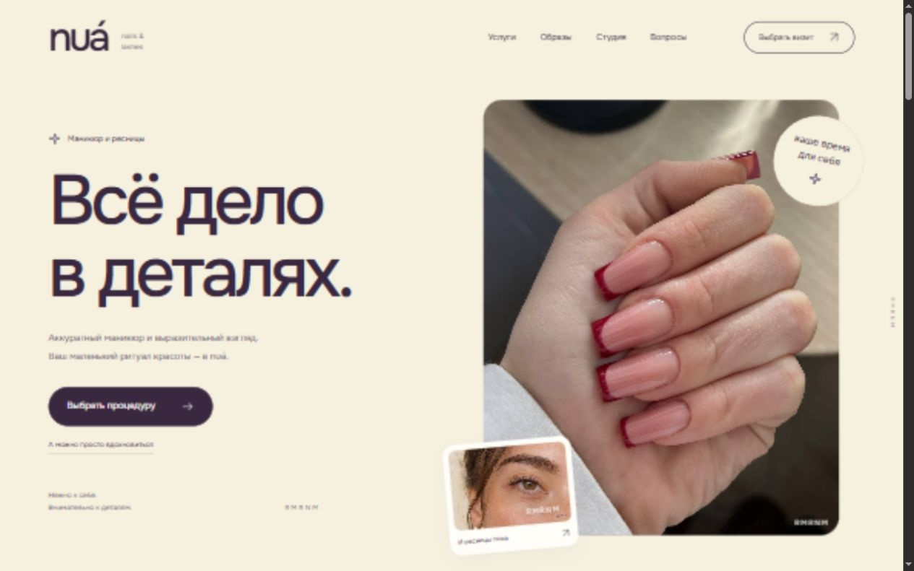

# nuá · nails & lashes · RMRNM

Одностраничный сайт вымышленной студии маникюра и наращивания ресниц. Авторская работа для портфолио RMRNM.



Сайт: https://rmrv-n.github.io/nua-rmrnm/

## Визуальная идея

Сливочная основа, мягкий лиловый, контрастная слива, крупная типографика Onest. Главный кадр с маникюром и небольшой акцент на ресницы; отдельный раздел показывает вторую специализацию мастера. Три фотографии маникюра предоставлены пользователем. Третий кадр аккуратно приближен средствами вёрстки, исходное фото сохранено без изменений. Ресницы и интерьер являются иллюстрациями imagegen. RMRNM размещена в оформлении фотографий.

## Что работает

- Якорная навигация и мобильное меню.
- Переключение между маникюром и ресницами: шесть процедур с ценой и длительностью.
- Галерея четырёх образов, фильтры, увеличение, стрелки и управление клавиатурой.
- Выбранный в галерее образ переносится в план визита вместе с подходящей процедурой.
- Дополнения меняют стоимость и время, при смене процедуры несовместимые дополнения сбрасываются.
- Выбор желаемой даты и примера времени. Прошедшие даты не принимаются.
- Итоговый план явно сообщает, что реальная запись не создана.
- Раздел студии, ответы на вопросы и информация об авторском проекте.
- Адаптивная вёрстка, локальные кириллические шрифты, WebP, видимый фокус, reduced motion и модальные окна.

Ни контакты, ни личные данные не запрашиваются. Заявки и платежи не отправляются. Время, цены и длительность демонстрационные. Студия вымышлена. Маникюр показан на фотографиях пользователя, ресницы и интерьер иллюстративные.

## Запуск

Node.js 20+, сторонние зависимости не требуются.

```sh
node serve.mjs
```

Открыть http://127.0.0.1:4177 . Готовая страница: `dist/index.html`, её также можно открыть как локальный файл.

```sh
node --check dist/assets/app.js
node verify.mjs
```

GitHub Pages публикует `dist/` из `.github/workflows/pages.yml`; выбран источник GitHub Actions. При push в main публикация обновляется.

## Исходники и материалы

- `dist/index.html` — единственная страница, контент и окна.
- `dist/assets/style.css` — оформление и адаптивная вёрстка.
- `dist/assets/app.js` — услуги, галерея, расчёт и план визита.
- `dist/assets/*.webp` — оптимизированные фотографии с RMRNM.
- `notes/design.md` — концепция, палитра и первичные референсы.
- `notes/image-prompts.md` — промпты встроенного imagegen и пути всех изображений.
- `notes/verification.md` — результаты проверки.

## Авторство

© 2026 RMRNM. Права на оригинальный дизайн, код, тексты и визуальные материалы сохранены. Публичная доступность репозитория не предоставляет лицензию на перепубликацию.

RMRNM встроена в фотографии, паттерн, оформление и метаданные. Абсолютно исключить удаление водяного знака невозможно. Контекстное меню и выделение текста не блокируются.

Шрифт Onest распространяется отдельно по SIL Open Font License; уведомление находится в `dist/assets/licenses/`. Все шрифты локальные, для работы сайта повторно загружать их не нужно.
